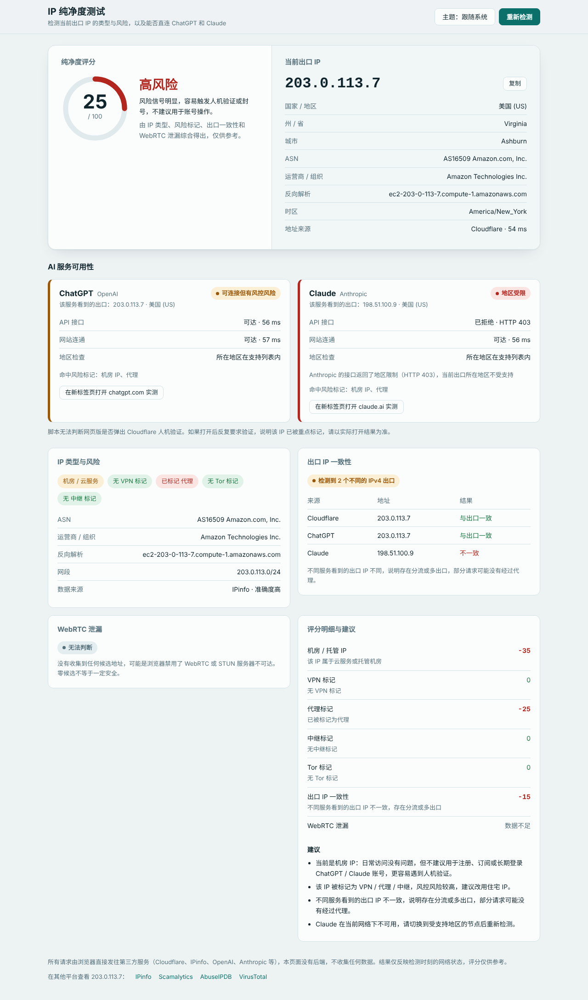

# IP 纯净度测试

一个纯前端的 IP 质量检测工具：检测当前出口 IP 的类型与风险、能否直连 ChatGPT 和 Claude、不同服务看到的出口是否一致，以及 WebRTC 是否泄漏真实地址，最后给出 0–100 的纯净度评分。

所有请求由浏览器直接发往第三方服务，**没有后端、不收集任何数据**，可以部署在任何静态托管上。



## 功能

- **出口 IP 识别**：多个数据源自动回退，显示国家/地区、城市、ASN、运营商、反向解析与时区，支持一键复制。
- **IP 类型与风险**：识别机房/云服务、住宅宽带、商业宽带、教育网，并展示 VPN、代理、中继、Tor、移动网络等标记。
- **AI 服务可用性**：分别检测 ChatGPT（OpenAI）与 Claude（Anthropic），区分「可直连」「有风控风险」「地区受限」「无法连接」，并给出 Cloudflare 判定地区与支持列表的比对结果。
- **出口一致性**：对比出口 IP、ChatGPT / Claude 域名看到的出口、IPv6 探测结果，发现分流或多出口。
- **WebRTC 泄漏**：通过 STUN 收集候选地址，区分公网 / 内网 / mDNS，标出绕过代理暴露的真实地址。
- **评分与建议**：按检测项扣分并给出针对性建议，评分明细可追溯。
- **主题**：跟随系统 / 浅色 / 深色，选择保存在本地。

## 检测原理

| 检测项 | 数据来源 |
| --- | --- |
| 出口 IP | Cloudflare `cdn-cgi/trace` → IPinfo → ipify → ipapi.co，取第一个有效结果 |
| IP 情报 | IPinfo widget → ip-api.com（仅 HTTP 页面）→ IPinfo 基础信息 → ipapi.co，均失败时按 ASN / 组织名启发式推断 |
| AI 服务 | `<host>/cdn-cgi/trace` 判断连通与地区。官方 API 返回 400/401/404/405/429，或返回带错误 JSON 且不属于地区限制的 403，视为可达；地区限制单独标出。没有错误 JSON 的 403 视为封禁 |
| 出口一致性 | 按 IPv4、IPv6 分别比对上述来源的地址，同一协议内出现不同出口才算不一致 |
| WebRTC | 多个 STUN 服务器收集 ICE 候选地址 |

隐私类标记（VPN / 代理 / 中继 / Tor）的扣分合计最多 60 分。评分规则：

| 项目 | 扣分 |
| --- | --- |
| 机房 / 托管 IP | 35 |
| 商业宽带 | 10 |
| VPN 标记 | 25 |
| 代理标记 | 25 |
| 中继标记 | 20 |
| Tor 标记 | 60 |
| 出口 IP 不一致 | 15 |
| WebRTC 泄漏 | 15 |

总分 ≥ 85 为「纯净」，≥ 60 为「一般」，否则为「高风险」。若所有 IP 情报来源都不可用，则显示「无法评分」而不是 0 分。机房、VPN、代理、中继、Tor 有缺项，且现有结果仍会落到「纯净」时，同样显示「无法评分」。

## 本地运行

无需安装依赖或构建：

```bash
# 方式一：直接双击 index.html

# 方式二：起一个静态服务
python -m http.server 8000
# 然后访问 http://localhost:8000
```

## 部署

纯静态站点，上传 `index.html` 和 `assets/` 即可。宝塔面板 + Nginx + HTTPS 的完整步骤见 [部署步骤.md](部署步骤.md)。

注意：HTTPS 页面会拦截明文 HTTP 请求，因此备用数据源 `ip-api.com` 在线上会被自动跳过，首选的 IPinfo 正常时不影响结果。

## 项目结构

```
index.html              页面骨架与主题初始化
assets/css/style.css    样式与浅色/深色主题变量
assets/js/data.js       服务定义、支持地区、ASN 与关键词配置
assets/js/api.js        统一请求层（超时、取消、错误归一化）
assets/js/checks.js     出口 IP、IP 情报、AI 服务、WebRTC 等检测
assets/js/score.js      扣分规则与评分
assets/js/ui.js         DOM 渲染与主题切换
assets/js/app.js        检测编排与增量渲染
部署步骤.md              宝塔 + Nginx + HTTPS 部署清单
参考/                   设计稿与界面预览图（不参与线上运行）
```

## 已知限制

- 脚本无法判断网页版是否弹出 Cloudflare 人机验证，ChatGPT / Claude 的最终可用性请以实际打开结果为准。
- 结果只反映检测时刻的网络状态；切换节点或代理规则后请点击「重新检测」。
- 评分仅供参考，不代表任何服务商的实际风控判定。
- OpenAI / Anthropic 的支持地区列表随官方政策变化，需同步更新 `assets/js/data.js` 中的地区码与 `regionsChecked` 日期。

## 隐私

页面没有后端，不写入 Cookie，不收集或上传任何检测结果。所有请求由访问者浏览器直接发往 Cloudflare、IPinfo、ipify、ipapi.co、OpenAI、Anthropic 等第三方服务，同时也会发起 STUN 请求用于 WebRTC 检测。

## 更新日志

### 2026-11-24

*V1*：
- 修复问题：WebRTC 不再把另一协议的公网地址算作泄漏
- 修复问题：官方 API 已返回非地区限制的 JSON 403 时，服务显示为可直连
- 修复问题：风险标记不完整时不再给出纯净满分
- 修复问题：不同的 IPv6 出口会标为不一致
- 修复问题：服务看到的出口与已评估 IP 不同时，不再套用该 IP 的风险标记
- 修复问题：Claude 的 permission_error 不再一律判为地区受限
- 修复问题：ip-api.com 备用请求补上 query 字段，以便校验返回的是目标地址
